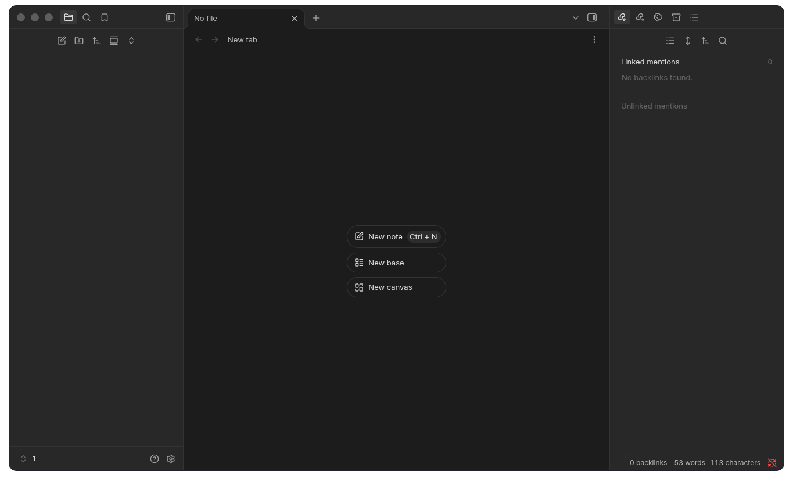

# obsidian-whitesur-titlebuttons

A CSS snippet that replaces Obsidian's default Linux title bar buttons with [WhiteSur GTK](https://github.com/vinceliuice/WhiteSur-gtk-theme) style buttons.

# Screenshots

Screenshot 1 shows the default right-side layout; screenshot 2 shows the macOS-style left-side layout.

# Installation

1. Copy `whitesur-titlebuttons.css` to your vault's `.obsidian/snippets/` folder
2. Open Obsidian → Settings → Appearance → CSS Snippets
3. Enable **whitesur-titlebuttons**

# macOS-style buttons on the left

By default the buttons stay on the right. To move them to the left in macOS order (close, minimize, maximize):

1. Install the [Style Settings](https://github.com/mgmeyers/obsidian-style-settings) plugin
2. Open **Settings → Style Settings → WhiteSur Title Buttons**
3. Turn on **Left titlebar buttons (macOS style)** (in Chinese: **左侧标题栏按钮（macOS 风格）**). The setting label follows Obsidian's interface language; off keeps the buttons on the right.

In left mode the left sidebar toggle stays visible: it sits to the right of the traffic lights when the sidebar is collapsed, and at the far right of the sidebar header when the sidebar is open. The window buttons remain fully clickable.

This applies to the main window and popout windows. The choice is manual: a CSS snippet cannot read the GTK `button-layout` setting. Following the system setting automatically would require a companion plugin.

Without Style Settings, add the `whitesur-buttons-left` class to the `body` element with another plugin or custom CSS.
